# A=B Auto Solver & Game Automation

[简体中文](README.zh-CN.md) | English

Automatically generate A=B programs and validate them in the original game. This fork adds a Windows desktop launcher and an in-game bridge to the [upstream solver](https://github.com/huangxs139/Game-A2B-auto-solver).

The repository contains six chapters, 47 puzzles, 126,626 input/output cases, and 47 answers accepted by the upstream owner.

## Quick start: Windows application

1. Download `A2B_Assistant_v0.2.0.exe` from [Releases](https://github.com/DeianHsu/Game-A2B-auto-solver/releases/latest) for 64-bit Windows.
2. Install A=B through Steam, then double-click `A2B_Assistant_v0.2.0.exe`.
3. Choose a starting point and click **开始自动验证**. Opening the launcher does not start a run.

The single executable includes Python, its dependency, and the game bridge. On first launch it prepares resources automatically; later launches reuse the cache. There is no installation wizard or manual extraction. The launcher locates the game, deploys the bridge, and starts A=B when needed. If the game is running without the bridge, close it before starting the launcher workflow.

| Starting point | Behavior |
| --- | --- |
| First puzzle | Revalidate all puzzles, including solved puzzles. |
| Current puzzle | Start with the puzzle currently open in the game and revalidate subsequent puzzles. Open the intended puzzle before clicking Start. |
| First unsolved puzzle | Skip solved puzzles and process the remaining unsolved puzzles. |

For each puzzle, the launcher obtains an answer, opens the level, fills the editor, starts game validation, waits for the result, and returns to the level menu. Puzzle failures are logged and the next puzzle runs; loss of the bridge connection stops scheduling. Pause, resume, and stop controls are available.

Game progress determines which puzzles are solved. It is separate from the accepted answers bundled with the solver. Resource caches live under `%LOCALAPPDATA%/A2B-Autoplay/runtime/`; settings, logs, and save backups live under `%LOCALAPPDATA%/A2B-Autoplay/data/`. Use **打开备份和日志** to open that directory. Updates preserve this data. Automated runs do not modify the repository's owner-controlled `.solve` decisions.

**5-5 is slow:** the current multiplication program took **53 minutes 16 seconds** in one complete run on the development machine. The launcher already uses the game's fastest native mode and displays case progress and elapsed time. The multiplication algorithm has not been optimized in this fork.

## Technology stack

| Area | Implementation |
| --- | --- |
| Desktop application | C#, .NET Framework, Windows Forms |
| Game integration | BepInEx 5.4.23.5 plugin; tested with Unity 2020.3.26f1c1 / Mono |
| Solver | Python 3.14; application embeds CPython 3.14.0 |
| Rules | YAML loaded with PyYAML 6.0.3 |
| Local communication | TCP on `127.0.0.1:17850`, one JSON request/response per line |
| Puzzle and solution data | JSON `.a2b` inputs and `.solve` states |
| Build and distribution | PowerShell, .NET Framework C# compiler, embedded resources, compressed runtime cache, single-file EXE |

## Implementation

```mermaid
flowchart LR
    A[Windows launcher] -->|Local TCP / JSON| B[Unity bridge]
    A -->|Reuse answer or synthesize| C[Python solver]
    C --> D[Executor and YAML Rules]
    B --> E[A=B game]
    E -->|Validation result| B
```



The launcher first reads an accepted answer. If none is available, it invokes the existing Python solver and Manager-owned full local validation. The solver recognizes transformations from puzzle data, generates native A=B programs using chapter-specific templates, and evaluates candidates through the shared Executor.

The bridge performs level selection, editor updates, execution, and menu navigation on Unity's main thread. It waits for editor layout updates before running multiline code and reports success only after all game cases finish. This local interface is implemented by this project; it is not an official game API.

| Source | Responsibility |
| --- | --- |
| `windows_autoplay/bootstrap/` | Embedded-resource preparation, cache reuse, and launching the desktop application |
| `windows_autoplay/launcher/` | Desktop interface, starting-point selection, scheduling, backups, and logs |
| `windows_autoplay/bridge/` | Game-side API and execution-state observations |
| `tools/autoplay_candidate.py` | Accepted-answer reuse and read-only synthesis fallback |
| `src/manager.py` | Python orchestration, full local validation, and candidate persistence |
| `src/solver.py`, `src/solver_framework.py` | Candidate synthesis and proposal/feedback lifecycle |
| `src/executor.py`, `src/rules/` | A=B execution semantics and authoritative rules |
| `test_data/`, `test_output/` | Puzzle inputs and saved solution states |

The solver targets the existing six-chapter puzzle set. Local validation and a game's successful run remain distinct from the project's owner-controlled acceptance decisions.

## Command-line solver

With Python 3.14 available, run from the repository root:

```bash
python -m pip install -r requirements.txt
python a2bautosolver.py solve c1_1_atob
python a2bautosolver.py solve all --max-concurrency 3
```

A targeted run uses the full puzzle identifier, forces Debug execution, and leaves saved solution state unchanged. `solve all` skips puzzles with pending, accepted, or rejected candidates; missing candidates and `re-solve` states require work. The bundled 47 accepted states therefore make an unchanged checkout skip all puzzles. Chapter concurrency affects the Python solver, while game automation runs one puzzle at a time.

For answers without running either tool, see [verified answers](user_docs/Verified-Answers.md).

## Build the Windows application

On 64-bit Windows, with A=B installed, Python available, and the .NET Framework C# compiler present:

```powershell
.\tools\build_autoplay.ps1 -GameDirectory 'D:\Game\Steam\steamapps\common\A2B' -Python 'python'
```

The script downloads pinned runtime dependencies, compiles the launcher and bridge using the locally installed game libraries, embeds the complete payload, and creates `dist/A2B_Assistant_v0.2.0.exe`. Set `-Version` to change the version in the filename and executable metadata. Game assemblies are not redistributed. Build caches, binary packages, local experiments, and generated verification documents stay out of Git.

## License

[MIT License](LICENSE). The upstream copyright notice is retained, with an additional notice for DeianHsu's contributions. Third-party components retain their own licenses. The project's MIT license does not grant rights to A=B itself or game-derived materials owned by Artless Games or other rights holders.
