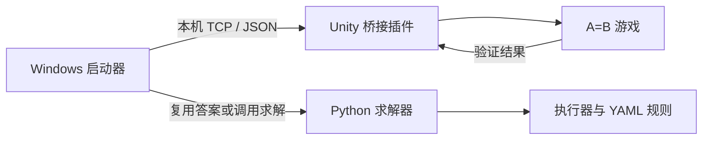

# A=B 自动求解与游戏验证

简体中文 | [English](README.md)

自动生成 A=B 程序，并在原版游戏中验证。本仓库在[上游求解器](https://github.com/huangxs139/Game-A2B-auto-solver)基础上增加了 Windows 桌面启动器与游戏桥接插件。

仓库包含六章 47 道题、126,626 组输入输出用例，以及上游所有者已验收的 47 份答案。

## 快速使用：Windows 程序

1. 从[发布版本（Releases）](https://github.com/DeianHsu/Game-A2B-auto-solver/releases/latest)下载 `A2B_Assistant_v0.2.0.exe`，适用于 64 位 Windows。
2. 通过 Steam 安装 A=B，然后双击 `A2B_Assistant_v0.2.0.exe`。
3. 选择起点，点击“开始自动验证”。仅打开程序不会自动运行。

单个程序文件已内嵌 Python、所需依赖和游戏插件。首次打开自动准备资源，后续复用缓存，无安装向导或手工解压步骤。启动器会查找游戏、部署插件并按需启动 A=B；首次部署时，如果游戏已运行且尚未加载插件，请先退出游戏。

| 起点 | 行为 |
| --- | --- |
| 从第一关开始 | 重新验证全部关卡，包括已通过关卡。 |
| 从当前关开始 | 从游戏当前打开的关卡开始，重新验证当前关及其后所有关卡；点击开始前先在游戏中打开目标关卡。 |
| 从首个未通过关卡开始 | 跳过已通过关卡，只处理剩余未通过关卡。 |

程序逐题获取答案、选关、填入代码、启动游戏验证，等待结果后返回选关界面。关卡失败时记录并继续下一关；插件断开或游戏退出时停止调度。支持暂停、恢复和停止。

是否已通过以游戏存档为准，与求解器随包提供的已验收答案分开。资源缓存位于 `%LOCALAPPDATA%/A2B-Autoplay/runtime/`，设置、日志和存档备份独立保存在 `%LOCALAPPDATA%/A2B-Autoplay/data/`，可通过“打开备份和日志”按钮查看。更新程序保留这些数据。自动运行不修改仓库 `.solve` 文件中的人工接受决定。

**5-5 耗时较长：**现有乘法程序在本机一次完整运行中耗时 **53 分 16 秒**。启动器已使用游戏原生最快模式，并显示用例进度和已用时间；本分支尚未优化乘法算法。

## 技术栈

| 部分 | 实现 |
| --- | --- |
| 桌面程序 | C#、.NET 框架（.NET Framework）、Windows 窗体（Windows Forms） |
| 游戏桥接 | BepInEx 5.4.23.5 插件；已验证游戏版本为 Unity 2020.3.26f1c1 / Mono |
| 求解器 | Python 3.14；程序内置 CPython 3.14.0 |
| 规则加载 | YAML、PyYAML 6.0.3 |
| 本机通信 | 传输控制协议（TCP），回环地址 `127.0.0.1:17850`，每行一条 JavaScript 对象表示法（JSON）请求或响应 |
| 题目与解答 | JSON 格式的 `.a2b` 输入和 `.solve` 状态 |
| 构建与分发 | PowerShell、.NET Framework C# 编译器、内嵌资源、压缩运行缓存、单文件 EXE |

## 整体实现



启动器优先读取已验收答案；缺少时调用现有 Python 求解器，并通过管理器（Manager）执行完整本地验证。求解器（Solver）从题目数据识别变换规律，使用分章节模板生成原生 A=B 程序，再由共享执行器（Executor）检验候选。

桥接插件在 Unity 主线程中执行选关、修改编辑器、运行与返回菜单操作。填入多行代码后等待布局更新，全部游戏用例完成后才报告成功。该本地接口由本项目提供。

| 源码位置 | 职责 |
| --- | --- |
| `windows_autoplay/bootstrap/` | 准备内置资源、复用缓存并启动桌面程序 |
| `windows_autoplay/launcher/` | 桌面界面、起点选择、顺序调度、备份和日志 |
| `windows_autoplay/bridge/` | 游戏端接口与运行状态观察 |
| `tools/autoplay_candidate.py` | 读取已验收答案，缺少时只读求解 |
| `src/manager.py` | Python 调度、完整本地验证和候选保存 |
| `src/solver.py`、`src/solver_framework.py` | 候选合成与提议、反馈循环 |
| `src/executor.py`、`src/rules/` | A=B 执行语义与权威规则 |
| `test_data/`、`test_output/` | 原始题目与已保存解答状态 |

求解范围限定为现有六章题库。本地验证通过、游戏运行成功和项目所有者接受是不同的状态。

## 命令行求解

准备 Python 3.14，在仓库根目录运行：

```bash
python -m pip install -r requirements.txt
python a2bautosolver.py solve c1_1_atob
python a2bautosolver.py solve all --max-concurrency 3
```

指定单题须传入完整标识符，会强制定向调试且不覆盖解答状态。`solve all` 跳过已有候选且状态为 `pending`、`accepted` 或 `rejected` 的题目；缺少候选或状态为 `re-solve` 时才求解。因此，原样检出仓库会跳过随附的 47 份已接受解答。章节并发只影响 Python 求解器，游戏自动验证始终逐题执行。

仅查看答案可阅读[已验证答案](user_docs/Verified-Answers-zh-CN.md)。

## 从源码构建 Windows 程序

需要 64 位 Windows、已安装的 A=B、可用 Python，以及 .NET Framework C# 编译器：

```powershell
.\tools\build_autoplay.ps1 -GameDirectory 'D:\Game\Steam\steamapps\common\A2B' -Python 'python'
```

构建脚本下载固定版本依赖，引用本机游戏库编译启动器和插件，再内嵌完整资源生成 `dist/A2B_Assistant_v0.2.0.exe`。通过 `-Version` 参数可更改文件名和程序元数据中的版本号。程序不包含游戏程序集。构建缓存、二进制、实验和临时验证文档不提交到 Git。

## 许可证

采用 [MIT 许可证（MIT License）](LICENSE)，保留上游版权声明，并追加 DeianHsu 的新增贡献声明。第三方组件遵循各自许可证。项目的 MIT 许可不授予 A=B 游戏本体及 Artless Games 或其他权利人拥有的游戏衍生材料的权利。
